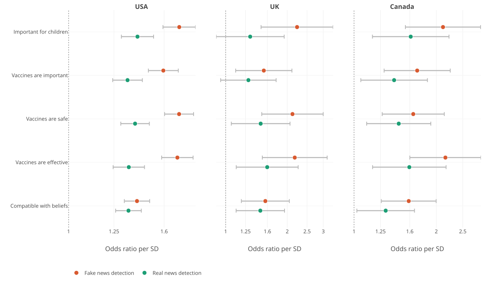

::: {.callout-note collapse="true"}
## How to run

* Default (`quarto render _master.qmd`): re-reads the raw file and loads the
  most recent results CSVs in `outputs/`. No model training.
* Retrain: `quarto render _master.qmd -P RUN_MODELS:true -P SAMPLE:3`
:::

```{python}
#| tags: [parameters]

RUN_MODELS   = True
SAMPLE       = 3
```


# 1. Initial setting

## Loading packages

```{r echo=TRUE, message=FALSE, warning=FALSE}
#| label: setup
#| message: false
#| warning: false

reticulate::py_require("plotly")
reticulate::py_require("kaleido==0.2.1")
source("code/00_initial.R")

output <- "output/"
```

[Back to top](#top)


# 2. Data preparation

## Data and recode

```{r}
source("code/01_config.R")
source("code/02_data_prep.R")
```

[Back to top](#top)


# 3. Data review

## Missing and descriptive statistics

```{r}
source("code/03_descriptive.R")
```

[Back to top](#top)
</br>


# 4. Bayesian 2PL IRT

## Fitting 2PL

```{r}
# source("code/04_irt_2pl.R")
```

[Back to top](#top)

## MIST scores

```{r}
# source("code/05_mist_scores.R")
```

[Back to top](#top)

# 5. Outcome model

```{r}
# source("code/06_outcome_models.R")
```

[Back to top](#top)

# 6. G-Computation using machine learning

## Posterior predictive checks

```{r}
#| label: run-08
#| cache.extra: !expr c(file.mtime("R/08_ppc_prior.R"), file.mtime("R/jags/2pl_prior.jags"))

# source("code/07_ppc_prior.R")
```

[Back to top](#top)

# 7. Figures

```{r}
# source("code/08_main_figures.R")
# source("code/09_figures.R")
# source("code/10_state_map.R")
# source("code/11_interaction.R") # By politics
# source("code/12_ability_by_ideology.R") # By politics
```

```{r}
#| label: fig-uptake
#| fig-cap: "Figure 1. Association between headline detection ability and vaccine confidence, by country"
#| fig-cap-location: top
#| out-width: "100%"
#| fig-align: center
#| echo: false


```

::: {.fig-note}
*Note.* Markers on the X-axis are odds ratios estimated from country-specific multilevel models, while horizontal lines indicate 95% CIs. Odds ratios are per 1 SD increase in detection score. The dashed line marks the null (odds ratio 1). Models used post-stratification weights and adjusted for sociodemographic covariates, perceived ease of access to and affordability of vaccination, and first-level administrative region. Samples comprise 11,380 respondents in the USA, 946 in the UK, and 920 in Canada.
:::

[Back to top](#top)