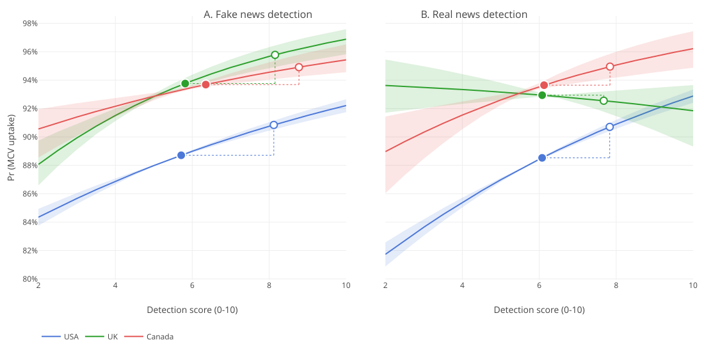

# 1. Initial setting

## Loading packages

```{r echo=TRUE, message=FALSE, warning=FALSE}
#| label: setup
#| message: false
#| warning: false

reticulate::py_require("plotly")
reticulate::py_require("kaleido==0.2.1")
source("code/00_initial.R")

output <- "output/"
```

[Back to top](#top)


# 2. Data preparation

## Data and recode

**데이터**

이 연구의 데이터는 런던위생열대의학대학원(London School of Hygiene & Tropical Medicine, LSHTM)의 백신 신뢰 프로젝트(Vaccine Confidence Project, VCP)가 게이츠 재단(Gates Foundation)의 지원을 받아 수행한 예방접종 지표 및 모니터링 연구(Immunisation Metrics and Monitoring Studies, IMMS) 프로젝트를 통해 수집되었다. IMMS 조사는 2025년 23개국에서 양육자를 대상으로 백신 신뢰, 예방접종의 행동적·사회적 동인(WHO BeSD 프레임워크), 정보 환경 및 미디어 이용, 제도적 신뢰, 정치적 성향에 관한 응답을 수집하였다. 본 연구는 2025년 9월에 수집된 미국, 캐나다, 영국 3개국 양육자 14,555명의 자료를 사용하였다(eSupplement 1). MIST 모듈은 영어권 환경에서 유통되는 정보를 중심으로 개발되었기 때문에(Maertens et al. 2023) 이 3개국에서만 시행되었다. 현지 조사는 ORB International이 수행하였으며, 가장 최근의 인구총조사 추정치를 기준으로 성별(50:50)과 1단계 행정구역에 따른 층화 확률표집을 사용하였다. 본 연구는 LSHTM 연구윤리위원회(IRB)의 승인을 받았다(승인번호 31474).

조사는 3개국 모두에서 온라인으로 시행되었다. 온라인 모집은 확률표본을 구성하지 않으며, 모집이 어려웠던 현지 조사 후반부에 일부 할당 기준이 완화되었기 때문에, 사후층화 가중치를 적용하여 최종 표본을 원래의 할당 목표에 맞게 재조정하였다. 또한 실제 성별 비율이 45:55의 허용 범위를 벗어난 경우에는 성별 가중치를 추가로 적용하였다.

초기 표본에는 두 가지 방식으로 결측 자료가 포함되어 있었다. 20개의 MIST 문항은 JAGS(Just Another Gibbs Sampler) 모형 내에서 헤드라인 탐지 점수를 추정하는 데 사용되었으며, 이 모형에서 관측되지 않은 응답은 각 마르코프 연쇄 몬테카를로(MCMC) 반복마다 추정되는 미지의 값으로 처리되었다. 나머지 모든 변수의 결측값은 분석에서 제외하였다. MIST 문항을 제외한 결측 비율은 정치적 성향 3–4%, 교육 수준 1–3%, 소득 2–4%, 고용 상태 0.5–0.6%, 연령 0–0.3%였다. 이러한 결측값이 있는 관측치를 제외한 후 최종 표본은 미국 11,380명(91%), 영국 946명(95%), 캐나다 920명(92%)이었다(자세한 내용은 eSupplement 2 참조).

**종속변수**

두 가지 유형의 종속변수를 분석하였다. 첫째, 헤드라인 탐지 능력과 백신 신뢰 간의 연관성을 평가하기 위해 백신 신뢰 지수(Vaccine Confidence Index, VCI)를 사용하였다. VCI는 백신이 (i) 모든 연령대의 사람에게 중요하다, (ii) 아동에게 중요하다, (iii) 안전하다, (iv) 효과적이다, (v) 개인적·철학적·종교적 신념과 양립한다는 데 대한 동의 여부를 나타내는 다섯 개의 이분형 문항으로 구성된다. 각 문항은 4점 리커트 척도로 측정되었으며 "모르겠다" 응답도 허용되었다. "매우 동의한다"와 "대체로 동의한다"는 1로, 나머지 세 응답은 모두 0으로 코딩하였다.

둘째, 양육자가 자가 보고한 막내 자녀의 홍역 함유 백신(measles-containing vaccine, MCV) 접종 여부를 분석하였으며, 이는 반사실적 예측의 기초로도 사용되었다. 국가별 예방접종 일정(캐나다의 경우 주 및 준주별 일정)에 따라, 권장 연령 구간 내에 MCV 1차 접종을 받은 아동은 1로, 그렇지 않은 경우는 0으로 코딩하였다(국가별 MCV 1차 접종 권장 연령은 eSupplement 4 참조).

**정치성향 및 통제변수**

아래에 기술된 헤드라인 탐지 능력이 정치적 성향에 따라 어떻게 달라지는지, 그리고 헤드라인 탐지 능력과 백신 신뢰 간의 연관성을 조절하는지 검토하기 위해 정치적 성향 변수를 활용하였다. 정치적 성향은 "진보적 가치와 전통적 가치의 척도에서 귀하는 자신을 어디에 위치시키십니까?"라는 질문을 사용하여 진보–보수 축을 따라 측정하였다. 응답은 진보(1–2), 중도(3–4), 보수(5–6)의 세 범주로 구분하였다.

개인 수준의 교란변수로는 성별, 교육 수준(중등교육 이상이면 1), 연령(18–34세, 35–44세, 45세 이상), 인종·민족(백인, 흑인, 아시아인, 기타), 종교(기독교, 이슬람교, 기타, 무교), 거주 지역(도시, 교외, 농촌), 고용 상태(취업 시 1), 주관적 소득 수준(기본적인 생필품을 감당할 수 있거나 그 이상이면 1)을 포함하였다.

예방접종 모형에서는 예방접종 서비스에 대한 인지된 접근 용이성과 백신에 대한 인지된 비용 부담 가능성을 추가로 통제하였으며, 두 변수는 각각 원래의 4점 척도에서 세 범주(전혀 또는 약간 용이함, 보통, 매우 용이함)로 재코딩하였다. 자세한 조사 문항과 코딩 방식은 eSupplement 5에 제시하였다.

```{r}
source("code/01_config.R")
source("code/02_data_prep.R")
```

[Back to top](#top)


## 헤드라인 탐지 능력: Fitting Bayesian 2PL

이 연구의 독립변수는 MIST(Maertens et al. 2023; Roozenbeek et al. 2020)를 바탕으로 추정한 헤드라인 탐지 능력이다. MIST는 실제 뉴스 헤드라인 10개와 가짜 뉴스 헤드라인 10개로 구성되며, 응답자에게 각 헤드라인을 참 또는 거짓으로 분류하도록 요청한다(전체 문항은 eSupplement 3 참조). Loomba et al. (2021)을 따라, 두 개의 독립된 2모수 로지스틱(two-parameter logistic, 2PL) 문항반응이론(item response theory, IRT) 모형을 사용하여 개인의 가짜 뉴스 헤드라인 탐지 능력($f$)과 실제 뉴스 헤드라인 탐지 능력($r$)을 각각 추정하였으며, $k \in \{f, r\}$이다. $Y_{ijk} \in \{0, 1\}$은 응답자 $i$가 블록 $k$의 문항 $j$ ($j = 1, \dots, 10$)를 올바르게 분류했는지를 나타낸다. 올바르게 탐지할 확률은 다음 모형으로 추정하였다.

$$
Y_{ijk} \sim \text{Bernoulli}(p_{ijk}), \qquad \operatorname{logit}(p_{ijk}) = a_{jk}\,(\theta_{ik} - b_{jk})
$$ {#eq-2pl}

여기서 $\theta_{ik}$는 블록 $k$에서 응답자 $i$의 잠재적 탐지 능력이다. $b_{jk}$는 문항 $j$의 난이도로, 예를 들어 거의 모든 응답자가 맞힌 문항은 난이도가 낮다. $a_{jk}$는 변별도로, 능력이 증가함에 따라 정답 확률이 얼마나 가파르게 증가하는지를 나타낸다. 사전분포로는 잠재 능력의 위치와 척도를 고정하기 위해 $\theta_{ik} \sim N(0, 1)$을, $a_{jk} > 0$을 보장하기 위해 $\log a_{jk} \sim N(0, 0.5^2)$을, 그리고 $b_{jk} \sim N(0, 2^2)$을 사용하였다. 여기서 표준편차 2는 문항 난이도가 응답자 능력 분포보다 두 배 넓은 범위에서 변할 수 있도록 하는 약정보적(weakly informative) 사전분포이다.

사후분포를 추정하여 블록 내 각 문항을 올바르게 분류할 확률을 구하고, 이 확률들을 합산하여 올바르게 분류할 것으로 기대되는 헤드라인 문항 수 $M_f$와 $M_r$을 산출하였다.

$$
M_{f,i} = \sum_{j=1}^{10} \operatorname{logit}^{-1}\!\left\{a_{jf}\,(\theta_{if} - b_{jf})\right\}, \qquad
M_{r,i} = \sum_{j=1}^{10} \operatorname{logit}^{-1}\!\left\{a_{jr}\,(\theta_{ir} - b_{jr})\right\}
$$ {#eq-mist}

따라서 각 점수는 응답자 $i$가 각 블록에서 올바르게 분류할 것으로 기대되는 문항 수를 의미한다.

$M_f$와 $M_r$로부터 세 가지 파생 지표를 산출하였다. $M_v = M_f + M_r$은 전반적인 진위 판별력(veracity discernment)으로, 응답자가 두 블록 전체에서 올바르게 분류할 것으로 기대되는 헤드라인의 총수를 나타내며 0에서 20 사이의 값을 갖는다.

응답 편향은 두 능력 간의 차이로 계산하였다. 실제 뉴스조차 조작된 것으로 분류하는 경향인 불신 편향(distrust bias)은 다음과 같이 정의하였다.

$$
M_d = E\left[\max(M_f - M_r,\ 0)\right]
$$ {#eq-distrust}

반대로, 조작된 뉴스조차 실제 뉴스로 분류하는 경향인 순진성 편향(naivety bias)은 다음과 같이 정의하였다.

$$
M_n = E\left[\max(M_r - M_f,\ 0)\right]
$$ {#eq-naivety}

```{r}
# source("code/04_irt_2pl.R")
```

[Back to top](#top)


# 3. Data review

## Missing and descriptive statistics

```{r}
source("code/03_descriptive.R")
ft3
```

[Back to top](#top)
</br>

## MIST scores

```{r}
# source("code/05_mist_scores.R")
```

[Back to top](#top)

# 4. Statistical Analysis

다섯 개의 백신 신뢰 문항 각각에 대해, 1단계 행정구역(미국은 주, 캐나다는 주 및 준주, 영국은 Government Office Regions)에 무작위 절편을 둔 가중 이항 로지스틱 회귀를 사용하여 결과 모형을 추정하였다.

$$
\operatorname{logit}\{\Pr(Y_i^k = 1)\} = \beta_1^k M_{f,i} + \beta_2^k M_{r,i} + \gamma_1^k \bar{M}_{f,s[i]} + \gamma_2^k \bar{M}_{r,s[i]} + X_i'\gamma_k + u_{s[i]}^k
$$ {#eq-outcome}

여기서 $X_i$는 개인 수준 공변량을, $u_s^k$는 무작위 효과를 나타낸다. Mundlak (1978)을 따라 지역 평균 $\bar{M}_{f,s[i]}$와 $\bar{M}_{r,s[i]}$를 포함하여 지역 내 변동과 지역 간 변동을 분리함으로써, $\beta_1^k$와 $\beta_2^k$가 지역 간 차이에 의해 오염되지 않도록 하였다. 주요 관심 모수는 가짜 뉴스 헤드라인 탐지 점수에 대한 $\beta_1^k$와 실제 뉴스 헤드라인 탐지 점수에 대한 $\beta_2^k$이다. 두 점수는 모두 표준화하였으며, 결과는 1 표준편차 증가당 오즈비로 제시하였다. 정치적 성향에 의한 조절 효과는 $M_f$와 정치적 성향 간의 상호작용항을 포함한 별도의 모형에서 검정하였다.

MMR 접종 가능성은 두 가지 차이를 제외하고 동일한 모형 설정으로 추정하였다. 첫째, 예방접종을 위해서는 서비스에 접근할 수 있고 비용을 감당할 수 있어야 하므로, 예방접종 서비스에 대한 인지된 접근 용이성과 백신에 대한 인지된 비용 부담 가능성을 공변량으로 추가하였다. 둘째, 백신 신뢰는 헤드라인 탐지 능력과 접종 사이의 그럴듯한 매개변수이다. 신뢰를 통제하면 이 간접 경로가 차단되어 직접 효과만 남게 된다. 따라서 주 접종 모형에서는 신뢰를 제외하였고, 주요 신뢰 문항을 통제한 모형을 함께 제시하였다. 두 모형 간의 차이는 연관성 중 어느 정도가 신뢰를 통해 작용하는지를 나타낸다.

$M_f$와 $M_r$은 관측값이 아니라 추정값이다. IRT 모형은 각 응답자에 대해 하나의 숫자가 아니라 그럴듯한 점수의 범위를 산출한다. 이 범위의 평균만 사용하면 추정된 양을 알려진 값처럼 취급하게 되어, 그 결과 표준오차가 실제 불확실성을 과소추정하게 된다. 따라서 각 응답자의 분포에서 $D$개의 사후 표본을 추출하고, 각 표본마다 회귀모형을 한 번씩 적합한 뒤, 루빈의 규칙(Rubin's rules)을 사용하여 추정치를 결합하였다. 민감도 분석으로, IRT 기대 점수 대신 원점수 합계를 사용하여 동일한 모형을 다시 적합하고 그 계수를 비교하였다.

모든 모형에는 사후층화 가중치를 적용하였다. 가중치는 결과 모형 단계에서만 적용하였다. IRT 모형은 모집단 평균이 아니라 개인의 응답 과정을 추정하는 것이므로 가중치 없이 적합하였다.

추정은 R 4.4.0에서 수행하였다. 베이지안 추론에는 rjags를 사용하였으며, 수렴은 Gelman-Rubin 통계량, 유효 표본 크기, 추적 그림(trace plot)으로 평가하였다(Plummer 2008).

# 5. Results: Outcome models

## Figure 1. Association between headline detection ability and vaccine confidence, by country

그림 1은 세 국가 모두에서 가짜 뉴스 또는 실제 뉴스 헤드라인 탐지 점수가 높은 양육자일수록 더 높은 백신 신뢰를 보고하는 경향이 있음을 보여준다. 미국에서는 백신 신뢰와의 연관성이 실제 뉴스 헤드라인 탐지보다 가짜 뉴스 헤드라인 탐지에서 더 강하게 나타났다.

미국에서 가짜 뉴스 헤드라인 탐지 점수가 1 표준편차 증가할 때, 백신이 아동에게 중요하다는 데 동의할 오즈는 1.72배 높았다[95% 신뢰구간(CI) = 1.59, 1.87, P < .001]. 백신 안전성[OR = 1.72, 95% CI = 1.60, 1.85, P < .001], 효과성[OR = 1.71, 95% CI = 1.58, 1.84, P < .001], 모든 연령대에서의 중요성[OR = 1.59, 95% CI = 1.48, 1.72, P < .001]에서도 유사한 연관성이 관찰되었다. 신념과의 양립성에 대해서는 오즈비가 더 작았다[OR = 1.40, 95% CI = 1.32, 1.49, P < .001]. 이 문항에서 연관성이 약하게 나타난 것은 헤드라인 탐지 능력이 가치 기반 판단보다 사실 판단과 더 밀접하게 관련되어 있기 때문일 수 있다.

영국과 캐나다에서도 다섯 가지 백신 신뢰 결과 변수 전반에서 연관성은 양의 방향이었다. 영국에서 오즈비는 모든 연령대에서의 중요성에 대한 1.54[95% CI = 1.12, 2.11, P = .008]부터 아동에 대한 중요성에 대한 2.23[95% CI = 1.49, 3.35, P < .001]까지의 범위를 보였다. 캐나다에서 오즈비는 신념과의 양립성에 대한 1.59[95% CI = 1.26, 2.00, P < .001]부터 효과성에 대한 2.16[95% CI = 1.60, 2.91, P < .001]까지의 범위를 보였다.

실제 뉴스 헤드라인 탐지 역시 백신 신뢰와 양의 연관성을 보였으며, 미국과 캐나다에서는 다섯 가지 결과 변수 모두에서, 영국에서는 안전성, 효과성, 신념과의 양립성에서 통계적으로 유의하였다. 미국에서는 신념과의 양립성을 제외하면 오즈비가 대체로 가짜 뉴스 헤드라인 탐지의 오즈비보다 작았다. 예를 들어 아동에 대한 중요성의 경우, 실제 뉴스 헤드라인 탐지의 오즈비는 1.43[95% CI = 1.32, 1.55, P < .001]으로, 가짜 뉴스 헤드라인 탐지의 1.72[95% CI = 1.59, 1.87, P < .001]보다 작았다.

```{r}
# source("code/06_outcome_models.R")
knitr::include_graphics("output/fig_forest.svg")
```

::: {.fig-note}
*Note.* Markers on the X-axis are odds ratios estimated from country-specific multilevel models, while horizontal lines indicate 95% CIs. Odds ratios are per 1 SD increase in detection score. The dashed line marks the null (odds ratio 1). Models used post-stratification weights and adjusted for sociodemographic covariates, perceived ease of access to and affordability of vaccination, and first-level administrative region. Samples comprise 11,380 respondents in the USA, 946 in the UK, and 920 in Canada.
:::

[Back to top](#top)


## Figure 2. Predicted probability of vaccine confidence across misinformation detection ability, by country

> To be added

```{r}

```

[Back to top](#top)


## Figure 3. Fake and real headline detection ability across political orientation, by country

> To be added

```{r}

```

[Back to top](#top)


## Figure 4. Association between misinformation detection ability and vaccine confidence across political orientation, by country

> To be added

```{r}

```

[Back to top](#top)


# 6. Results: G-Computation

머신러닝 기반 g-computation을 사용하여 가짜 뉴스 헤드라인 탐지 능력이 가상적으로 증가할 때 모집단 평균 MCV 접종률이 어떻게 변하는지 추정하였다. 각 사후 표본마다 백신 신뢰 모형과 MCV 접종 모형의 두 가지 모형을 머신러닝 알고리즘[예: 랜덤 포레스트(ranger), 그래디언트 부스팅(xgboost)]으로 적합하였다. 백신 신뢰 모형에는 가짜 뉴스 탐지 점수와 공변량을, MCV 접종 모형에는 여기에 백신 신뢰를 추가하여 입력변수로 사용하였다. 두 모형 모두 사후층화 가중치를 적용하였고, 1단계 행정구역을 입력변수로 포함하여 지역 간 차이를 반영하였다. 머신러닝 모형은 함수 형태를 사전에 지정하지 않으므로, 탐지 능력, 백신 신뢰, 공변량 간의 비선형 관계와 상호작용을 자료로부터 학습할 수 있다.

이후 각 응답자의 탐지 점수를 일정량 $\delta$만큼 높인 상태에서 접종 예측 확률을 다시 계산하고, 이를 표본 전체에 대해 평균하였다. 백신 신뢰는 판별 능력과 접종 사이의 경로에 위치하므로, 고정하지 않고 탐지 점수와 함께 변하도록 하였다. 즉, 높아진 탐지 점수에서 백신 신뢰 모형으로 신뢰의 예측 확률을 구한 뒤, 신뢰가 있는 경우와 없는 경우의 접종 예측 확률을 이 확률로 가중평균하였다.

$$
\hat{P}_i(\delta) = \sum_{c \in \{0,1\}} \widehat{\Pr}\left(V_i = 1 \mid M_{f,i} + \delta,\ C_i = c,\ X_i\right)\, \widehat{\Pr}\left(C_i = c \mid M_{f,i} + \delta,\ X_i\right)
$$ {#eq-gcomp}

여기서 $V_i$는 MCV 접종 여부, $C_i$는 백신 신뢰, $X_i$는 공변량이다. 접종률의 변화량은 관측된 탐지 점수($\delta = 0$)에서의 평균 예측 확률과 $\delta$만큼 높인 상태에서의 평균 예측 확률 간의 차이로 정의하였다.

## Figure 5. Counterfactual projections of MCV uptake across misinformation detection ability, by country

마지막으로 그림 5는 분석을 MCV 접종으로 확장하여, 헤드라인 탐지 능력의 변화가 백신 신뢰를 거쳐 MCV 접종으로 어떻게 이어지는지를 예측한 결과를 보여준다. 가짜 뉴스 헤드라인 탐지의 경우, 세 국가 모두에서 탐지 점수가 높을수록 예측 MCV 접종률이 높았다. 증가 폭은 미국에서 가장 가팔랐으며, 예측 MCV 접종률은 탐지 척도의 하단에서 약 82%였던 것이 상단에서는 약 92%로 상승하였다. 영국과 캐나다에서는 기울기가 더 완만하였으나, 가짜 뉴스 헤드라인 탐지 능력이 향상될수록 예측 MCV 접종률 역시 증가하였다. 각국의 현재 평균 탐지 점수에서 예측 MCV 접종률은 미국 약 89%, 영국과 캐나다 93–94%였다.

실제 뉴스 헤드라인 탐지에 대한 예측 결과는 국가별로 차이를 보였다. 국가별 현재 평균 점수에서 예측 MCV 접종률은 영국과 캐나다에서 약 93%로 비슷하였으며, 미국은 약 88–89%였다. 미국에서는 실제 뉴스 헤드라인 탐지 능력이 높을수록 예측 MCV 접종률도 높았다. 캐나다에서도 이와 유사한 양의 기울기가 나타났다. 반면 영국에서는 실제 뉴스 헤드라인 탐지 능력이 높아질수록 예측 MCV 접종률이 소폭 감소하였으며, 불확실성 구간도 상대적으로 넓었다.

```{r}
#| label: run-08
#| cache.extra: !expr c(file.mtime("R/08_ppc_prior.R"), file.mtime("R/jags/2pl_prior.jags"))

# source("code/07_ppc_prior.R")

```

::: {.fig-note}
*Note.* Solid lines show the population-average predicted probability of MCV uptake across false- and real-news headline detection scores, while shaded areas indicate 95% uncertainty intervals. Large circles indicate each country’s current mean detection score and corresponding predicted MCV uptake. Estimates are based on the primary sequential g-computation specification, in which vaccine confidence is first predicted under each counterfactual detection score and then propagated into the MCV uptake model. Models used post-stratification weights and adjusted for sociodemographic covariates, perceived ease of access to and affordability of vaccination, and first-level administrative region.
:::

[Back to top](#top)

# 7. Figures

```{r}
# source("code/08_main_figures.R")
# source("code/09_figures.R")
# source("code/10_state_map.R")
# source("code/11_interaction.R") # By politics
# source("code/12_ability_by_ideology.R") # By politics
```

[Back to top](#top)